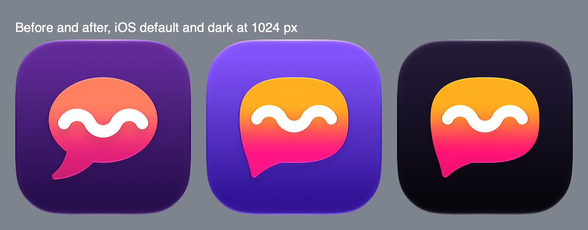
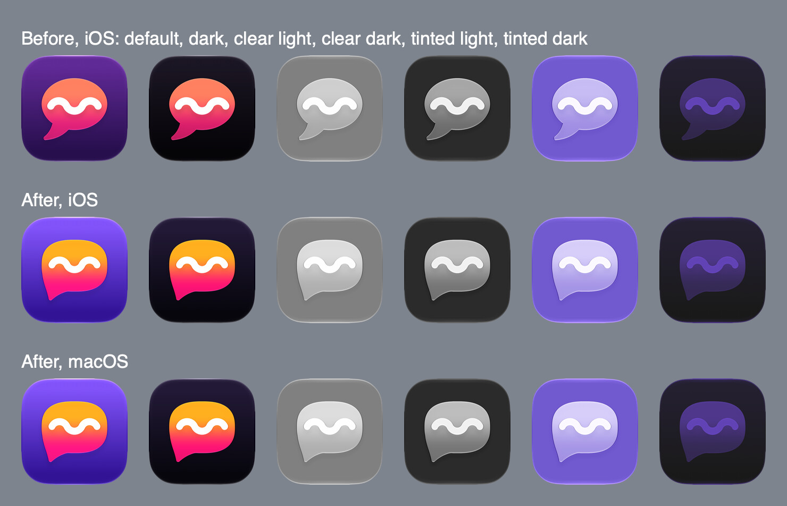
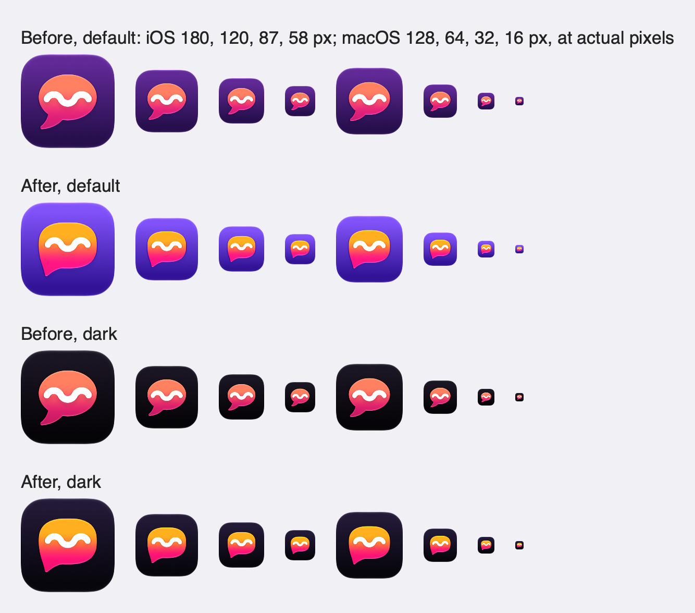
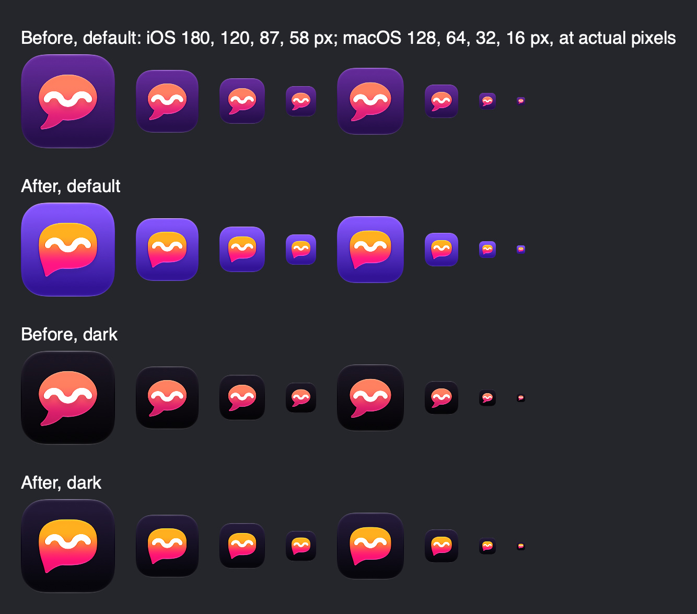

# App icon

`Shared/AppIcon.icon` is the one Icon Composer bundle both apps compile (`ASSETCATALOG_COMPILER_APPICON_NAME = AppIcon`); the keyboard shows the containing app's icon. `distribution/mumla-mbag/icon.svg` is its flat copy for the download page.

The mark is a mumble balloon: comics draw half-heard speech as a squiggle in a balloon, and its three arcs also form a cursive m. The balloon's body is a superellipse rather than an ellipse, and its tail grows out of the left side, so it reads as Mumla's own shape rather than a Messages bubble or a letter P.

| Part | Value |
| --- | --- |
| Background | `#7A55F0` → `#2E1590`, top to bottom, Display P3; dark `#211A35` → `#07060C` |
| Back group: `1-balloon.svg` | superellipse body, exponent 2.6, 636 × 500 centred at (512, 470), with a wedge tail to the lower left and filleted joins; fill `#FFB547` → `#FF3D7F` from y 0.24 to 0.8; translucency 0.25, neutral shadow 0.5 |
| Front group: `2-squiggle.svg` | three alternating 130° arcs of radius 80 centred on y 462, 68 px round-capped white stroke; neutral shadow 0.3 |

- Layer SVGs are flat white shapes; colour lives in `icon.json` so appearances can vary it. The first entry in `groups` draws in front. An appearance-specific background needs every value inside `fill-specializations`, including one entry without `appearance`.
- Clear and tinted appearances are the system's renderings of the white layers.
- Keep the squiggle's arc radius at least 1.15 × its stroke width, or the troughs pinch into notches.
- The web copy uses the same paths and colours inside the system's continuous-corner mask. Change both together.

`ictool` in `Icon Composer.app/Contents/Executables` renders any appearance without Xcode's UI: `ictool Shared/AppIcon.icon --export-image --output-file icon.png --platform iOS --rendition Dark --width 1024 --height 1024 --scale 1`. Renditions are `Default`, `Dark`, `ClearLight`, `ClearDark`, `TintedLight` and `TintedDark`.

