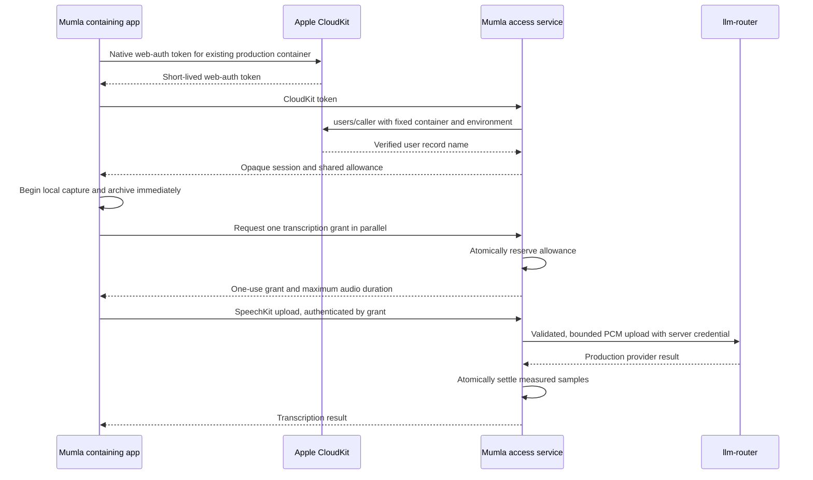

# Mumla access service

Status: approved design, revised for the access-service implementation review.
Service tests and builds do not replace the live app/device acceptance gates.

## Decision and scope

Mumla owns one small access proxy. It verifies the iCloud account, issues
opaque device sessions, reserves the monthly allowance, validates and meters
transcription input, and forwards admitted traffic to llm-router. The router
keeps provider credentials and inference transport. It gains no Mumla identity,
quota, subscription, subject-usage or delegated-token feature.

New builds have one transcription operation: MAI-Transcribe-2 in clean mode,
including progressive upload and batch recovery. There is no model picker,
provider branding, separate cleanup, screen-context capture, personal key entry,
or key baking in any app channel. SpeechKit retains its other providers for
other applications. Historical result/model identifiers remain readable; removing
selection must not rewrite stored history or synchronized profiles.

The free allowance is **60 processing minutes per calendar month per iCloud
account**, shared across iPhone, iPad and Mac. The service also supports a
private, larger allowance for the maintainer's verified subject. That policy
uses the same admission, metering and account checks; it grants no bypass key.

Pro is a later change: $6.99/month or $49.99/year through StoreKit, presented as
unlimited with a disclosed 30-hour monthly fair-use ceiling. No purchases,
entitlement verifier, paywall or Pro UI belong in this first implementation.

The identity guarantee is one allowance per iCloud account, not proof of one
physical person. Multiple Apple accounts remain possible. All platforms use the same verified
CloudKit identity path and account quota. App Attest is a possible response to
measured abuse, not launch scope: an identity-only path must remain available,
and a platform string cannot prove that a caller is a Mac. Adding attestation
now would add verifier and key-lifecycle complexity without closing that path.

The launch scope has been checked against the required dictation workflow.
Separate cleanup is excluded by the product decision; later additions require
their own supported-operation contract. Individual usage observations and pricing
analysis remain outside this public document.

## Boundaries and alternatives

| Owner | Responsibility |
| --- | --- |
| Containing app | Current local iCloud account, session refresh, capture/archive, normal finalization at the grant boundary, result insertion |
| Keyboard | Existing commands and transcript ownership; typed access status from the containing app |
| Access service | Verified identity-to-subject mapping, sessions, allowance policy, reservations, supported operations, validation, metering and bounded forwarding |
| Router | Existing principal authorization, provider credentials, routing and inference transport |
| Apple | CloudKit identity proof; later, signed StoreKit transactions |

A direct app-to-router signed-token design would distribute admission and require
a new router ledger and protocol-aware metering. Reading completed router
metadata cannot reserve concurrent work. Token expiry cannot stop already-open
streams. A product module inside the router would couple product identity and
commercial policy to the credential gateway. Calling providers directly would
duplicate credential ownership. The colocated proxy keeps these responsibilities
with Mumla at the cost of a local forwarding hop.

The decision follows The Pragmatic Programmer topics 9 (one owner for policy),
23 (explicit contracts), 34 (transactional shared state) and 43 (least privilege).
The replaceable boundary is the private router connection. Account ownership,
allowance semantics and future purchase ownership are the expensive contracts.

## Identity and automatic sessions

The service has a fixed production CloudKit container. Its public CloudKit API
token and service origin are release inputs. The API token identifies the
container; it is not user authentication or a shared inference credential.
Apps verify the configured container against their existing entitlement. There
is no bootstrap endpoint, operation discovery or client-selected model.

The app checks `CKContainer.accountStatus()`, then obtains a fresh token with
`CKFetchWebAuthTokenOperation(apiToken:)` on the existing container's private
database, using `fetchWebAuthTokenResultBlock`. There is no Apple web sign-in
window. A missing, restricted, indeterminate or temporarily unavailable iCloud
account stays a distinct, visible state. No installation identity, old key or
anonymous allowance is substituted.

The service sends that token once to:

`GET https://api.apple-cloudkit.com/database/1/<fixed-container>/production/public/users/caller`

It supplies `ckAPIToken` and URL-encoded `ckWebAuthToken`, rejects redirects,
requires a successful response with one nonempty top-level `userRecordName`,
and ignores all names/contact fields. The live endpoint answered that flat
dictionary on 2026-10-28; Apple's archived reference still documents a `users`
array, which fails closed. No subject or
record name submitted by the app is authoritative. It discards both the native
token and any replacement web token returned by Apple. Timeout or ambiguous
exchange requires a new native token, not replay of the old one. The native
token authorizes more than identity lookup; the service limits its use to this
one fixed request and never reads or writes the private dictation library.
Apple's 421 authentication errors mean `invalid_identity`. Runtime 401
`AUTHENTICATION_FAILED` is a configuration incident, not a user identity error.
Startup checks the configured API token without a web token: `users/caller`
must answer 421
`AUTHENTICATION_REQUIRED`. Definite `ACCESS_DENIED`, 400/404, 401
`AUTHENTICATION_FAILED` or an unexpected 200 fails startup as an operator
incident. A transient network, DNS, timeout or server failure keeps the process up and gates only
enrollment with `503 identity_unavailable`. Enrollment retries the shared API
probe on demand with jittered exponential backoff from one second to about a
minute; a user proof is not sent until the API probe succeeds. The probe has a
three-second deadline; session use and transcription do not depend on CloudKit
availability. Runtime 401 `AUTHENTICATION_FAILED` reports
`cloudkit_configuration_invalid`; runtime 403/`ACCESS_DENIED` reports
`cloudkit_access_denied`. Both refuse that request with 503 and a rate-limited
incident log, without closing admission or exiting.

Only Apple receives those query credentials. Disable URL/query logging,
breadcrumbs and HTTP tracing for this exchange; accept user tokens only in POST
bodies on the Mumla endpoint, never its URLs.

SQLite stores a unique SHA-256 of the length-prefixed UTF-8 tuple
`(container, environment, userRecordName)`, mapped to a random, stable subject
UUID. Apple's record name is already opaque and scoped to its container; no
keyed hash or identity secret is needed. The UUID is not a credential. Preserve
the mapping in backup: losing it duplicates allowances and later purchase
ownership. Session rotation never changes this mapping.

### iPhone, iPad and Mac

All containing apps use the same native CloudKit exchange, UUID mapping and
quota. No App Attest endpoint, challenge/replay table, key, counter, verifier or
new capability is introduced. Replaying a valid CloudKit proof can only create
a session for that proof's Apple-verified account; it cannot select another
subject or reset the account's allowance. Apple accepted a replayed proof on
2026-10-28 and still accepted the same proof 233 minutes later, so a proof is a
bearer credential for at least several hours; a rejected one requires a fresh
native proof. Do not claim that this authenticates a genuine
app or proves a physical person.

### Keyboard

The keyboard neither captures audio nor makes inference requests. It keeps the
existing App Group/Darwin command and transcript-delivery bridge. The containing
app owns identity, session credentials and transcription grants.
No CloudKit token, service session or router credential is copied into the App
Group. Publish a typed access state mirroring `MumlaAccess.State`: `checking`,
`available`, `allowanceSpent(resetsAt)`, `iCloudUnavailable(reason)` and
`serviceUnavailable`, plus existing dictation state. Its available payload may
carry the allowance snapshot needed by the keyboard; it carries no credential.
The keyboard renders that state without handling credentials or refreshing them.

### Session lifecycle

Sessions are 256 random bits, bearer credentials transported over HTTPS, with
only their SHA-256 hashes stored server-side. They last 30 days, are scoped to
this service's access/allowance/grant endpoints, and are never accepted by the
router. There are no JWT claims, issuer registration, JWKS or signing-key
rotation contract. Renewal atomically exchanges a valid session for another 30-day session and
invalidates the old token; a fresh CloudKit proof is needed for initial
enrollment or after expiry/revocation. Renew proactively on foreground when
within seven days of expiry, outside capture's critical path. A session's 401
`invalid_session` invalidates the cached credential and triggers one fresh
enrollment, never a blind retry of an uncertain inference upload. Server
revocation expires the session and revokes its unused grants; a claimed upload
keeps its settlement owner. At 32 live sessions, enrollment evicts the
earliest-expiring (least recently renewed) session using that same rule rather
than blocking the account. Expired rows are removed automatically. A session can
spend only its own subject's allowance;
its longer lifetime does not raise that cap.

The app's one credential owner serializes refresh and keeps session credentials
in device-only Keychain storage. It validates local account continuity on foreground activation and
account notifications and observes `.CKAccountChanged`. Account
change invalidates local credentials and outstanding grants, publishes blocked
state and rebinds through a fresh proof; existing account-partition leases are
also respected. It must not transfer an in-flight result into the next account.
A compromised client can retain an issued credential until expiry or server revocation;
local sign-out is not remotely provable. The shared quota still applies.

## Service API

All replies use `Cache-Control: no-store`. Bodies are bounded. Authorization is
never accepted in query strings. JSON errors use stable `error.code`, with
`retry_after` or `resets_at` only when meaningful; no provider text or user
content is reflected into diagnostics.

| Endpoint | Authorization | Contract |
| --- | --- | --- |
| `POST /v1/sessions` | Fresh CloudKit proof, rate limited | Opaque session, expiry, subject UUID and allowance |
| `POST /v1/session/renew` | Session | Rotate this session atomically; same subject and allowance |
| `DELETE /v1/session` | Session | Revoke this session and any unclaimed grants issued under it |
| `GET /v1/access` | Session | Authoritative allowance snapshot, server time and reset time |
| `POST /v1/dictations` | Session | Atomically reserve one supported transcription attempt; return one-use grant, claim deadline and audio limit |
| SpeechKit's existing Azure transcription path | One-use grant | One bounded upload and provider response; claim grant atomically before dispatch |
| `GET /healthz` | Public | 200 with version/commit only when ready and admission is open; otherwise 503 |
| `GET /internal/status` | Operator only | SQLite, configuration and router readiness; aggregate active work and actionable failures |

A grant binds subject, account period, fixed transcription contract, reservation, session
and deadlines. Its opaque token is also 256 random bits, stored only by hash.
An unused grant expires after 30 seconds and releases its reservation. First
claim is an atomic transition; a second upload with it fails. A dispatched grant
is not reusable even if its client never receives the response. Do not retry an
uncertain inference send automatically. A new, explicitly requested attempt has
its own grant and charge. A lost grant response can temporarily reserve capacity
until its short claim deadline; it cannot produce upstream work twice.

The request/reply field contract uses snake_case JSON and ISO 8601 timestamps
with offsets. `/v1/dictations` requires integer `maximum_audio_seconds` in 1...120, the apps' batch ceiling. This is an enforceable upper
bound, never a trusted consumption report. Its reply includes `token`,
`claim_expires_at`, `request_deadline`, `audio_limit_samples` and an updated
allowance. The sample rate is fixed by the operation. A batch client asks for its
validated recording's rounded duration; if the returned limit is smaller, it
does not dispatch and lets that unused grant expire. Progressive capture asks
for the operation maximum and stops at the returned sample bound.

Allowance fields are `limit_seconds`, `used_seconds`, `reserved_seconds`,
`period_start`, `resets_at` and `observed_at`. Remaining values are derived. The
session reply includes `token`, `expires_at`, `subject` and `allowance`;
`subject` is never used as authorization. Reject unknown and contradictory
fields and duplicate JSON keys at every nesting level. Bound session input to 16
KiB and other JSON grant requests to 1 KiB, both with a two-second body
deadline. Authenticate a grant request before reading its body. Pass the
authenticated session into synchronous session operations. Grant insertion
rechecks the session token and expiry atomically after its body read. No
response includes an operation catalog. A retryable 503 grant refusal is retried
automatically. A fence-revoked grant returns 401 `invalid_grant`; request a new
grant without re-enrolling. No inference was dispatched under that
refused/revoked grant.

The grant is represented to existing SpeechKit factories as `LLMRouter` with
the access-service origin and the grant as its bearer. This reuses production
SpeechKit transports without introducing token policy into SpeechKit or the
router. Identity sessions cannot call inference paths and grants cannot mint
sessions or further grants. Refresh for later requests does not interrupt an
already admitted upload.

## Supported operation and metering

The service has one explicit clean-transcription handler with the fixed
contract below. Adding another supported operation later requires its own
validation, metering and live tests; the identity/session/ledger contract stays
unchanged. Do not build a catalog endpoint, descriptors or plugin interfaces.

| Rule | Initial contract |
| --- | --- |
| Transport | POST multipart upload to `/vendors/azure-speech/speechtotext/transcriptions:transcribe`; no WebSocket upgrade |
| Model/options | `api-version=2025-10-15`, enhanced `MAI-Transcribe-2`, clean style, no diarization; accept omitted timestamps or `"none"` and forward explicit `"none"` |
| Audio | Exactly one canonical PCM16 little-endian, mono, 16,000 Hz WAV; the existing SpeechKit streaming-header sentinel is accepted for progressive upload |
| Other input | One bounded definition before audio; existing language and dictionary filtering, at most one supported locale and 50 compatible hints; no audio URLs, extra files or arbitrary prompts |
| Limit | At most 120 seconds of audio per attempt, at most 180 seconds total request lifetime from grant issuance and 16 KiB definition/framing overhead |
| Output | One synchronous transcription result; a bounded response, no persistent upstream object or polling capability |
| Recovery | The same operation on a WAV derived from the archived original; a separate, visibly accounted attempt |

Validate header fields and the definition before any audio is forwarded. Do not
trust filename, Content-Type, RIFF length, client duration or Content-Length as
proof of audio duration. Meter the actual data samples as they pass the
validator. Reconstruct the bounded outgoing multipart envelope so a later
unvalidated field cannot alter provider behavior. Reject malformed or partial
samples, unsupported chunks/codecs, mismatched batch lengths, high-bit magic
bytes, duplicate fields, compressed bodies, unexpected query/options and
trailing payload. Do not run a media decoder or accept arbitrary provider
formats in this slice. Reject any bytes after the first `\r\n--boundary--`
recognized by Busboy, requiring exactly `\r\n` then EOF, including across chunk
boundaries. Compare each preamble byte as it arrives, before dispatch. Bound
outgoing batch audio to the smaller of its declared length and grant limit, then
reject excess bytes without forwarding or charging them. A claimed upload must
provide the validated WAV header and first complete PCM sample within three
seconds; its whole attempt remains bounded by the 180-second deadline.
Incomplete uploads must sustain a cumulative floor of 8,000 parser-received PCM
samples per second spent waiting for client input, after a ten-second grace.
Busboy's byte counter measures arrival independently of upstream consumption.
Upstream backpressure pauses that clock; only waiting on client input can become
a charged client timeout. Check progress periodically with a monotonic clock;
silence or trickling cannot reset the budget. Failure aborts both sides, charges
measured input under the client-failure rule and frees the idle hold. Clear that
timer when upload completes, so provider response latency does not look like a
slow client. SpeechKit's pinned progressive transport appends each captured PCM
batch to its live upload; ordinary capture supplies 16,000 samples/second, and
batch recovery supplies it faster.

The edge is part of this deploy contract. Cloudflare's default request body
buffering holds about the first MiB of an upload, which delays progressive audio
past the claim window, so a zone configuration rule sets
`request_body_buffering: none` for the transcription path alone. Cloudflare's
125-second Proxy Read Timeout counts from when the service receives a request,
even while its body is still streaming, and only Enterprise zones can raise it.
A paced upload lasts as long as the recording, so the apps request progressive
grants of at most 110 seconds and batch transcriptions of at most 120 seconds,
which upload far faster than real time (both observed 2026-10-28). A direct
DNS-only host would lift the ceiling but expose the server's address.

The authoritative unit is integer PCM samples. At 16,000 samples/second, the
free month contains 57,600,000 samples. Report human-readable seconds in the
API; Swift converts them to `Duration`. Charge a produced transcript, a
client-caused failure of a claimed attempt, dispatched or not, including a
header-only stall or an invalid upload, rounded up to a whole second with a
one-second minimum, and charge exactly one second for a provider 400 or 422
input refusal. Every attempt an account causes therefore costs allowance, so a
stalled or rejected loop cannot hold the data pool or spend provider capacity
for free. Never charge connection failures, router-local refusals, other
provider 4xx and 5xx, invalid or unparsable 200 results, a fence or closed admission
before dispatch, or service crashes. A router 401/403 is an operator incident
that fences admission and restarts after live work finishes. Never infer
consumption from output word count or client reports.

Bun's streaming fetch remains the forwarding owner. Dispatch starts when fetch
pulls the rebuilt request body's first bytes, after validating the 44-byte WAV
header. A fence or closed admission refuses an undispatched claim with retryable
503 and no charge; the client resends with a new grant.

For progressive upload, reserve up to 110 seconds, or the remaining whole-second
allowance if smaller. Each app stops capture when that much wall-clock time has
passed since recording began, so an interruption pause or a stalled upload
cannot stretch the request toward the edge timeout, and leaves 15 seconds for
finalization, which took under a second at the bound (observed 2026-10-28); the
sample budget stays as a backstop. From 10 seconds before that deadline, the
recording UI shows the remaining time in place of the elapsed time. Start local
capture and archival immediately while requesting the grant in parallel. Begin
upload only after it arrives. The bound applies to already captured as well as
subsequent audio: upload at most that prefix, stop capture normally when the
bound is reached, and retain the whole original. If admission is refused,
archive what was captured and show spent, busy or unavailable state. Client
capture counts the converted provider samples and stops normally at the bound,
finishes the multipart stream and receives the transcript. It does not cancel
and lose the captured result. The archived original is retained. The server
independently refuses bytes beyond that bound; a malicious client cannot turn it
into a longer request. Batch recovery validates its complete WAV duration and
reserves the required rounded duration before dispatch; recordings beyond the
operation's maximum remain available for Listen/Export with a clear limit error.

No separate cleanup or screenshot bytes are sent in this first operation. Future
cleanup needs a bounded input/output and attempt rule, not free arbitrary text
requests attached to an audio-only meter. Future asynchronous providers require
subject-owned upload/job references and retained reservations until terminal
state. Future WebSocket operations require frame-level model/input validation,
sample or provider-session-time metering, aggregate concurrency and a hard
termination deadline; a transparent byte tunnel does not provide those checks.

## Durable allowance ownership

Use one SQLite database in WAL mode with `synchronous=FULL`, an exclusive live
service owner, foreign keys and unique constraints. A monthly usage row owns
settled samples; active reservation rows own admitted but unsettled samples.
Do not reconstruct either from traffic logs. SQL transactions enforce:

`spent + sum(active reservations) <= effective monthly limit`

Admission checks the current subject policy and at most two active attempts per
subject, then inserts its reservation under `BEGIN IMMEDIATE`. Grant claim and
dispatch state transitions are atomic. Settlement increments spent and removes
the reservation in the same transaction, only if that reservation still exists.
A duplicate callback cannot charge twice or release another request's hold.
No asynchronous work occurs inside these transactions.

The service uses UTC calendar months and returns the exact next reset instant;
clients display it in the user's local timezone. An attempt belongs to the
month in which its grant was created and must finish within its fixed deadline.
Crossing midnight never moves its charge to another month or releases its old
hold. Requesting new credentials, reinstalling or using another device cannot
reset the row. The free allowance and future Pro fair-use ceiling are validated
Mumla-service configuration, initially 60 minutes and 30 hours. Apps display the
returned limit and never hardcode either cap. Policy can change with provider
pricing without an app release; deploying new operator configuration uses the
same idle-wait and admission rules as code. A lower cap blocks new admissions when
already-used/reserved work exceeds it, without canceling previously admitted
bounded work. The invariant is enforced at admission against its policy snapshot.
Policy overrides are private mappings from stable subject UUID to larger monthly
limits, with no client-controlled tier or cap.

Cancellation closes both sides and settles only after forwarding has stopped,
using the charging rules above. A process crash releases dangling reservations on
startup and raises an operator incident; it does not charge the reserved maximum
for a transcript the client did not receive. Unclaimed grants release after their
deadline or an idle fence. A database/commit failure closes admission and logs a
content-free error class or SQLite code, lets current requests finish or fail,
then exits nonzero. The private poller owns admission reopening after restart;
the service never opens itself. A failed settlement cannot strand a
claimed row in the live count or indefinitely block shutdown. Startup recovery
releases any remaining hold.

Distinguish `allowance_exhausted` (spent) from `allowance_busy` (reserved on this
or another device). The latter does not say the user has spent the allowance.
Quota replies contain limit, used, reserved, server observation time and
reset time. In-flight consumption appears as a reservation until settlement.

Expired sessions and unused grants are reaped by their owning service. Closed
request details need not be retained. Keep monthly aggregates for the current
and previous two months; retain identity mappings and any future
purchase-ownership rows. Bound the total database, WAL, logs and deployment
artifacts. Never prune current usage, active reservations or identity mappings
to make space. Stop admission with at least one MiB of unused SQLite pages
before the page cap can produce `SQLITE_FULL`. The capacity incident is fatal
and startup fails the same reserve check: the service stays unavailable until
space is freed, while the private poller alerts the operator. The private unit
must set an explicit restart delay and start-limit policy; reaching that limit
requires operator reset/restart rather than guaranteed retries. Initial state
budget: 256 MiB including WAL; retain two release artifacts and bounded,
content-free logs. Online backups contain the SQLite snapshot in private
operator storage, with the latest two recovery points retained. Restoring an old
usage snapshot requires fencing admission and conservatively reconciling
accepted work, never resetting a month's spend.

## Client ownership and UI contract

One shared `@MainActor @Observable MumlaAccess` owns published access state;
a separate private networking owner serializes credentials and refresh. Each
coordinator exposes its access owner. Views consume state and request explicit
Retry; they do not poll or own credentials. This API is agreed with the UI owner:

- `MumlaAccess.State`: `checking`, `available(Allowance)`,
  `iCloudUnavailable(CKAccountStatus)`, `serviceUnavailable`.
- `Allowance`: `Duration` values `limit`, `used`, `reserved`; `Date resetsAt`.
- `remaining = max(.zero, limit - used)`; `available` additionally subtracts
  reservations; `isExhausted = used >= limit`. A reservation is not spending.
- `canDictate` derives from available capacity; `refresh() async` supports Retry.
- Typed iCloud states preserve `noAccount`, `restricted`,
  `temporarilyUnavailable` and `couldNotDetermine`.

Read/Listen/Export of existing history remains available when access is blocked.
Only new inference requires a grant. The containing app publishes the typed
keyboard block through the existing bridge; the keyboard cannot link this
CloudKit/networking owner. Account changes and foreground lifecycle events are
owned by the app's access component. Capture-limit finalization goes through
the existing coordinator mailbox rather than racing another lifecycle path.

Delete app-only provider selection, router-key storage/adoption, credential
editors and baking scripts after the UI's references are removed. Delete
superseded construction paths rather than keeping a hidden developer switch.
Use the access service for signed development builds too. Preserve historical
provider IDs as data, the existing account partitions, original archives,
privacy work and diagnostics rules. Unsigned builds can compile but cannot
promise CloudKit identity access. Update AGENTS.md, README, PRIVACY.md and
SUPPORT.md alongside the implementation, including the additional processor
that now sees inference traffic, identity/session metadata and retention.

## Hosting, release and rollback

Use a small Bun/TypeScript program under `services/access/`, reusing the
existing Bun services' SQLite approach. Use a maintained streaming multipart
parser for the narrow upload contract and Bun's `fetch` to stream the rebuilt,
validated multipart body to the local router. This is a protocol adapter, not a
transparent proxy; reject all upgrades. A focused streaming/abort/early-rejection
probe on the pinned runtime is a prerequisite.

Colocate it with llm-router on the existing small Linux VPS. Run under a
distinct unprivileged systemd user and separate state directory; bind loopback
and expose only its public HTTPS front door through the Cloudflare tunnel. Trust
its overwritten `CF-Connecting-IP` header only at this loopback boundary; it is
required only for enrollment, and a missing/invalid value refuses that request
with 503 and a rate-limited incident log rather than stopping the service. The
router connection is local. No new server or container platform is required.
Measure memory, latency and error rates before increasing capacity. At most 64
service data requests may be in flight. Authenticate the subject and check its
cap of four concurrent data requests before entering that global pool; all
sessions for the subject share this cap. Health and operator requests stay
outside that cap. Enrollment has eight separate slots and a two-second body
deadline; it never blocks the data pool or idle fence. Enrollment has a
per-origin rate limit (IPv4-mapped IPv6 normalized to IPv4; other IPv6 10 per
/64 and 100 per /48, so a shared carrier prefix is not one origin) and no shared
minute budget: a global count that unverified requests fill would
let a dozen origins lock out every sign-in, so concurrency slots and per-origin
limits bound verification instead. Acceptance must prove that the real client IP reaches this
boundary and that the tunnel forwards progressive request bodies before capture
ends. A client cannot trigger a deployment.

The router agent's agreed service principal is `mumla-access`, with
`access=[azure.transcription]`, an empty ladder and `archive=false`.
Its key remains server-only, with a generous existing router `key_limits`
entry above expected launch load as an emergency spend backstop against bugs or
account farming. This is config only, not a second per-person ledger. The router owner has confirmed that no native media
path is needed and committed this narrowed policy for review. The service still
enforces its narrower model, options, duration and input contract.
Do not put a router key, actual upstream origin, operator subject, profile,
private host or deploy identity in tracked defaults or logs. There is no router
per-subject usage-read endpoint or issuer configuration to add.

The single `ci.yml` admission checks the service, synthetic protocol/ledger tests,
dependency notices and Apple targets on relevant changes. Service notices live
under `services/access/`, outside the app-bundled notices and licenses. The repository's annotated plain version tag remains
the only release trigger and version for apps and service. Build one immutable
service artifact. Following the existing gateway deployment pattern, the VPS
polls admitted tags anonymously and deploys itself; public CI has no deploy
credentials.
The release waits for the actual HTTPS `/healthz` to report the exact tag and
commit before uploading app artifacts. Private deploy configuration owns the
repository access, ingress, secrets, backups and rollback mechanism.

Prepare and check the candidate while admission stays open. Ask the live service
for its dispatched-upload/backup count; unused grants and undispatched claims
do not count as active. Closing admission aborts undispatched claims with 503,
releasing their reservation without charge; the client requests a new grant.
An enrollment may be interrupted during an idle replacement, because it has no
durable work until its final admission recheck; closing admission cancels its
body/proof exchange and the client retries. The idle fence atomically revokes
unused grants, which incur no charge. Database rows alone are not proof of live
work. Wait with admission open for at most 15 minutes, then abort with admission
open if no idle window occurs. Once idle, atomically fence admission and confirm
idle again. If work won that race, reopen immediately and keep waiting within
the same bound. Replace only after confirmed idle; readiness must complete
within seconds, otherwise restore the previous artifact and reopen. The stable
ingress stays up. New requests see only a brief retryable unavailable state
while the process is replaced. Planned upgrades never kill active dictation or
strand a reservation. One process owns the database at a time. If sustained
traffic measurably causes idle-wait aborts, introduce a reviewed drain step or
overlapping slots; neither is required before that evidence.

A dispatched header-plus-one-sample stall can still occupy a slot for about ten
seconds of client-input grace at one second of allowance per grant, checked
every second. The free 3,600-second month bounds that to about ten aggregate
grant-hours per account; continuously occupying both allowed slots costs about
180 seconds per 15-minute deploy wait, or about 20 such waits per free month.
This paid interference remains a trigger for the reviewed drain step above.

Every boot starts fenced. The private operator status remains available while
closed. Public health is 200 only after readiness and reopening, so release
uploads cannot race a failed deploy. Readiness checks the offline snapshot, the
router's `/health` contract, and definite CloudKit API-token configuration
failures. A transient CloudKit outage does not block the running service's
readiness or existing sessions. The offline `check` command requires proven
CloudKit identity configuration: it prints `ready:false,identity:"unproven"`
and exits 75 for a retryable outage, preventing replacement with an unproven
candidate. Success prints `ready:true,identity:"proven"` and exits 0; definite
configuration failures exit 1. Only the live inference gate proves the router
credential and provider operation. This router-key readiness gap is accepted for launch: a wrong key
fails closed through the fatal 401/403 inference incident. The service publishes
the fixed backup path with mode 0640 by chmodding the temporary snapshot before
its atomic rename. Its private state directory is service-owned and
backup-group-readable with setgid mode 2750; live database/config access stays
separately restricted.

The private poller is the single owner of admission after an unplanned restart.
Outside a deploy, it reopens only a ready but fenced service, and sends a Lykta
alert. After three unplanned restarts within an hour it stops reopening and
alerts that the service needs the operator. Readiness failure, including exhausted
capacity, never permits reopening. The service keeps starting fenced.

Keep the previous artifact. Rollback is allowed only when it can read current
identity, session and quota state and the released app protocol. Additive schema
changes keep both versions compatible; destructive quota or identity migration
requires a separate reviewed transition. Restoring a backup is not an ordinary
rollback because it could erase accepted usage.

Existing operator-issued app keys retain their current router path until those
builds are updated. They provide no per-person allowance guarantee. Release
builds never embedded an install key; there is no public shared-key cohort to
migrate. New builds neither read that old credential nor silently fall back to
it. Do not revoke separately issued credentials as an incidental migration.

A change to the service is reviewed on `main`, accepted on an isolated dev
instance of that commit and on a device, then released by a tag. The tag deploys
the production service before uploading or distributing the app artifacts. Dev
acceptance uses the same production router adapter with synthetic audio,
without claiming the untagged instance is a production release.

## Later Pro integration

The existing subject UUID becomes StoreKit's `appAccountToken`. Verify Apple-signed
transactions and current entitlement on the service, and uniquely associate
`(store environment, originalTransactionId)` with one subject. Never let a client
assert Pro, choose its limit or replay a purchase under several iCloud accounts.
Restoration of purchases without an app account token, account changes, refunds
and Family Sharing need a defined ownership policy before selling Pro.

An entitlement raises the same monthly limit to 30 hours; it creates neither a
second allowance nor a second identity. An upgrade preserves already-used
samples. A downgrade prevents further admissions when use is already above its
new limit; previously admitted bounded work retains its reservation. Yearly
billing still has monthly fair-use windows. Price labels later come from
localized StoreKit products. No subscription tables or unused purchase APIs are
needed for the free launch beyond preserving stable subject ownership.

## Feasibility and acceptance gates

Approval of this record does not prove the following boundaries. Complete these
before merging the implementation or enabling the public endpoint:

1. On a real signed iPhone and Mac, obtain native tokens for the same production
   container, exchange them through `users/caller` without sign-in UI, and verify
   both select one service UUID. Prove a submitted record name is ignored and a
   replay cannot select another subject or reset usage. Check sign-out/account
   change, session rotation, expiry and revocation. Confirm an expired user token
   returns 421 from CloudKit, distinct from API-token authentication failure.

2. Through the app's actual SpeechKit factory, prove both progressive capture and
   batch recovery with language/dictionary settings, canonical WAV, a boundary
   vocabulary fixture and short synthetic audio. Exercise unknown-length uploads,
   chunk boundaries, cancellation, oversized/false headers and finalization. The
   adapter must neither buffer the recording nor lose an early provider rejection.

3. With isolated synthetic accounts/database, race two devices at the last seconds,
   replay a grant, cross a month boundary, crash after dispatch, fail settlement
   and restart. Assert durable spent-plus-reserved behavior and honest busy versus
   exhausted responses. Never manipulate production CloudKit or erase user data.

4. Verify no-setup dictation on real iPhone and Mac through the HTTPS service and
   production router; check shared subject/usage, normal finalization at the grant
   boundary and a clear spent state using an isolated test allowance. Keep the
   existing keyboard ownership/insertion acceptance separate from provider tests.

5. Confirm the actual release origin, API token,
   principal key, private subject override, backups and deploy health on their
   owners. Verify actual Cloudflare client-IP delivery and progressive body
   forwarding through that HTTPS route with a paced progressive upload that
   reaches the 110-second bound, including normal completion and cancellation. No provisioned
   token or production deployment is
   assumed to exist yet. Measure the added local hop on the dev instance.

Current evidence is source inspection, live documentation and read-only router
metadata. No native CloudKit exchange, service deployment,
new build, live integration test or physical acceptance was performed for this
record. All of those remain explicit implementation gates.

## First-party and implementation references

Checked on 2026-10-27:

- [Native CloudKit web-auth token](https://developer.apple.com/documentation/cloudkit/ckfetchwebauthtokenoperation)
- [CloudKit users/caller](https://developer.apple.com/library/archive/documentation/DataManagement/Conceptual/CloudKitWebServicesReference/FetchCurrentUserIdentity.html)
  and [request authentication](https://developer.apple.com/library/archive/documentation/DataManagement/Conceptual/CloudKitWebServicesReference/SettingUpWebServices.html)
- [Account availability and changes](https://developer.apple.com/documentation/cloudkit/ckcontainer/accountstatus(completionhandler:))
- [MAI-Transcribe model/options](https://learn.microsoft.com/en-us/azure/ai-services/speech-service/mai-transcribe)
  and [fast transcription](https://learn.microsoft.com/en-us/azure/ai-services/speech-service/fast-transcription-create)
- [Bun SQLite transactions and durability](https://bun.com/docs/runtime/sqlite)
  and [streaming fetch](https://bun.com/docs/runtime/networking/fetch)
- [StoreKit account association](https://developer.apple.com/documentation/storekit/product/purchaseoption/appaccounttoken(_:))
  and [server association for external purchases](https://developer.apple.com/documentation/appstoreserverapi/set-app-account-token)
